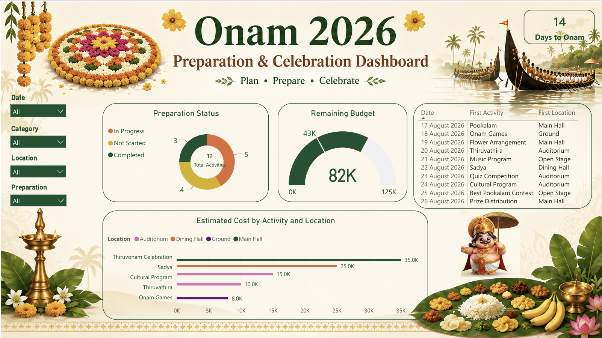

# 🌼 Onam 2026 Event Planning & Analytics

End-to-end event planning and analytics project for Onam 2026 using **Excel, SQL, Python, and Power BI** to manage budgets, registrations, participation, automation, and preparation insights.

## Objectives

- Model event, participant, registration and budget data in a relational database
- Analyse registrations, department-wise participation and event popularity
- Track planned vs. actual budget spend by category
- Automate event registration and the lucky draw with Python
- Present preparation progress and budget status in an interactive Power BI dashboard

## Repository Contents

| File | Description |
|------|-------------|
| `Onam_2026_PowerBI_Data_Updated.xlsx` | Source data (activities, locations, budget, calendar) used for the dashboard |
| `ONAM challenge.sql` | MySQL database, tables and 10 analysis queries |
| `Onam2026 Challenge.ipynb` | Python registration system with event statistics and lucky draw |
| `ONAM power BI.pbix` | 2-page Power BI dashboard (open with Power BI Desktop) |

## Tools & Technologies

- **Excel**: data collection and cleaning
- **SQL (MySQL)**: schema design, joins, aggregation
- **Python**: menu-driven registration and lucky draw automation
- **Power BI**: DAX measures and interactive dashboard

---

## 📊 Power BI Dashboard

**Page 1: Event Overview**
KPI cards (total activities, expected participants, estimated budget, budget spent, total locations, completed activities, days to Onam), expected participants by date and activity, budget split by category, and slicers for date, category, location and preparation status.


**Page 2: Preparation & Budget Tracking**
Estimated cost by activity and location, remaining budget gauge, preparation status breakdown, and a day-wise activity schedule.



---

## 🗄️ SQL Analysis

**Database schema:** `Participants`, `Events`, `Registrations` (linked by foreign keys) and `Budget`.

| # | Question answered |
|---|-------------------|
| 1 | Event schedule by date |
| 2 | Total participants |
| 3 | Registrations per event |
| 4 | Most popular event |
| 5 | Department-wise participation |
| 6 | Participants registered for multiple events |
| 7 | Event-wise participant names |
| 8 | Estimated budget by category |
| 9 | Remaining budget and budget utilisation |
| 10 | Top 5 events by estimated cost |

### Key results

**Registrations per event** (15 total registrations, 10 participants)

| Event | Registrations |
|-------|:---:|
| Thiruvonam Celebration | 3 |
| Pookalam Competition | 2 |
| Onam Games | 2 |
| Thiruvathira | 2 |
| Onam Sadya | 2 |
| Cultural Program | 2 |
| Music Program | 1 |
| Traditional Dress Contest | 1 |
| Best Pookalam Contest | 0 |

**Department-wise participation**

| Department | Registrations |
|------------|:---:|
| Data Analytics | 6 |
| Python | 3 |
| SQL | 3 |
| Power BI | 2 |
| Excel | 1 |

**Budget utilisation**

| Category | Estimated (₹) | Spent (₹) | Remaining (₹) | Utilisation |
|----------|---:|---:|---:|---:|
| Food & Sadya | 45,000 | 12,000 | 33,000 | 26.67% |
| Cultural Programs | 25,000 | 10,000 | 15,000 | 40.00% |
| Decoration | 20,000 | 9,300 | 10,700 | 46.50% |
| Games & Sports | 15,000 | 10,000 | 5,000 | 66.67% |
| Prizes & Gifts | 10,000 | 1,000 | 9,000 | 10.00% |
| Entertainment | 10,000 | 1,500 | 8,500 | 15.00% |
| **Total** | **1,25,000** | **43,800** | **81,200** | **35.04%** |

**Top 5 events by estimated cost:** Thiruvonam Celebration (₹35,000), Onam Sadya (₹25,000), Cultural Program (₹15,000), Thiruvathira (₹10,000), Onam Games (₹8,000).

---

## 🐍 Python: Registration & Lucky Draw System

A menu-driven program that automates event registration:

1. Register a participant (ID, name, department, age, gender, event)
2. View all registered participants
3. Search for a participant
4. View event-wise registration statistics
5. Run a random **Lucky Draw** among registered participants
6. Exit

Duplicate participant IDs and invalid event choices are validated before registration.

**Sample lucky draw output**

```
🎊 Congratulations! 🎊
--------------------------
Winner : Nitin
ID     : 1004
Event  : Cultural Program
--------------------------
🌼 Happy Onam 2026! 🌼
```

---

## 💡 Key Insights

- **Thiruvonam Celebration** is the most popular event with 3 registrations, and also the costliest at ₹35,000 estimated.
- **Data Analytics** is the most active department, with 6 of the 15 registrations.
- 5 of 10 participants registered for more than one event.
- Only **35%** of the ₹1,25,000 budget has been spent, leaving ₹81,200 remaining. All categories are within budget.
- **Games & Sports** has the highest budget utilisation (66.67%), so it needs the closest monitoring.
- **Best Pookalam Contest** has no registrations yet and may need more promotion.

## How to Use

1. Clone the repository
   ```bash
   git clone https://github.com/aryar96/Onam-2026-Event-Planning-Analytics.git
   ```
2. Run `ONAM challenge.sql` in MySQL to create the database and run the queries
3. Open `Onam2026 Challenge.ipynb` in Jupyter or VS Code and run the cells
4. Open `ONAM power BI.pbix` in Power BI Desktop to explore the dashboard

## Author

**aryar96**: [GitHub Profile](https://github.com/aryar96)
